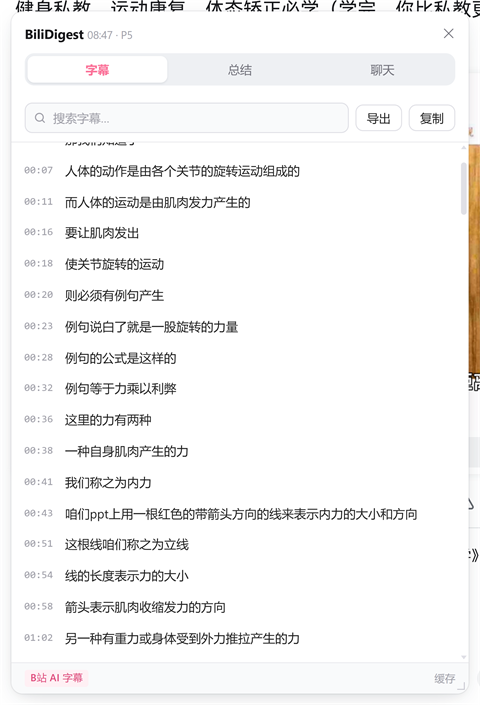
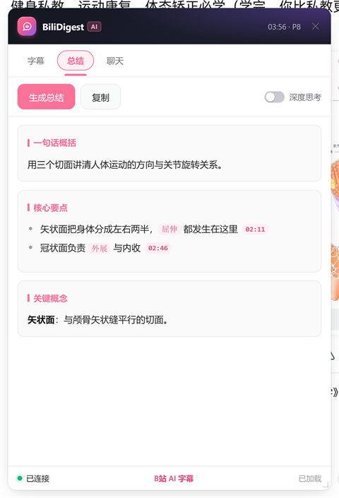
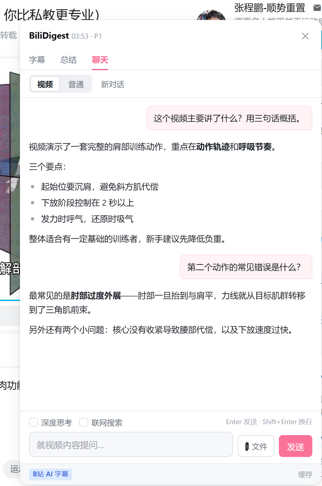

# BiliDigest

B站视频字幕 + DeepSeek AI 总结与问答，纯浏览器扩展，**不需要任何后端服务**。



| 总结 | 聊天 |
|---|---|
|  |  |

## 功能

| 标签 | 功能 |
|---|---|
| **字幕** | 自动获取 B站 AI 字幕 / UP主字幕；时间轴列表，点击跳转到对应时间；播放时自动高亮当前句；搜索；下载 TXT；复制全文 |
| **总结** | 用 DeepSeek 生成结构化总结（一句话概括 / 核心要点 / 关键概念 / 适合人群），流式输出 |
| **聊天** | 就视频内容与 DeepSeek 多轮对话，回答带时间戳引用 |

## 安装

1. 打开 `chrome://extensions/`（Edge 是 `edge://extensions/`）
2. 开启「开发者模式」
3. 点「加载已解压的扩展程序」→ 选择本项目的 `extension/` 目录
4. 进入任意 B站视频页，右下角出现红色的「字幕」按钮

> Chrome 137+ 不再支持命令行 `--load-extension`，必须手动加载。

**支持的浏览器**：Chrome / Edge / Brave / Opera / Vivaldi 等 Chromium 内核浏览器，代码无需修改。Edge 已实测。

Firefox 需要改造（`background.service_worker` 要换成 `scripts`，`host_permissions` 变成运行时授权），目前未适配。

## ⚠️ 免责声明

本项目通过 **DeepSeek 网页版的内部接口**（含 PoW 工作量证明）实现 AI 功能，属于逆向调用，**未获得官方授权**。由此产生的风险请自行评估：

- 可能违反 DeepSeek 的用户协议，**账号存在被限制的可能**
- 接口随时可能变更导致功能失效
- 每次对话的额度走的是你网页版的登录态

请仅用于个人学习。**不要用它做二次分发或商业用途。** 如需稳定长期的方案，请改用 DeepSeek 官方 API。

扩展不向任何第三方服务器发送数据。B站 cookie 与 DeepSeek token 只保存在你本机的 `chrome.storage.local` 里。

## 首次使用：登录两个站点

扩展需要两个登录态，都在设置页里管理（点扩展图标即打开）。

### 1. B站（获取字幕必需）

在本浏览器登录 [bilibili.com](https://www.bilibili.com)。未登录时 B站的字幕接口会返回空数组。

设置页会显示登录状态。如果显示未登录，用「刷新」按钮重新检测。

### 2. DeepSeek（总结与聊天必需）

设置页点「登录 / 同步登录态」→ 自动打开 `chat.deepseek.com` → 完成登录 → 回到设置页点「我已完成登录」。

token 会自动从页面的 `localStorage.userToken` 读取并保存。

> 如果读不到，可以手动粘贴：`chat.deepseek.com` → F12 → Application → Local Storage → `userToken` → 复制 `value` 字段。

## 使用

### 字幕

进入视频页后自动加载，右下角出现 B站红色的「字幕」按钮表示已就绪。点击展开面板。

- 点击任一句 → 视频跳转到该时间
- 视频播放时当前句自动高亮并滚动到视野内
- 「导出」导出带时间戳的 TXT：`[00:12] 字幕内容`
- 「复制」复制纯文本（不含时间戳）
- 面板右上角的 `✕` 收起面板，回到「字幕」按钮

### 调整面板位置和大小

面板默认固定在右下角（468px 宽、视口高度的 78%）。不想挡住视频时可以自己调：

| 操作 | 方式 |
|---|---|
| 移动面板 | 按住**标题栏**拖动 |
| 改变大小 | 拖动**右下角**的斜线把手 |
| 恢复默认 | **双击**标题栏或把手 |

尺寸和位置会自动记住，下次打开、甚至刷新页面后都保持不变。窗口变小（换显示器、改缩放）时会自动收进可视区域，不会跑到屏幕外面。

### 总结

切到「总结」标签 → 点「生成总结」。使用固定的系统提示词，输出固定结构，流式显示。

勾选「深度思考」会启用 DeepSeek 的推理模式（更慢但更准）。

### 聊天

聊天有两种模式，用顶部的「视频 / 普通」切换：

| 模式 | 说明 |
|---|---|
| **视频** | 就当前视频提问。首轮把字幕一起发给模型，后续轮次靠会话上下文 |
| **普通** | 不涉及视频，可以随便问，也可以上传文件让模型分析 |

**两个模式各自独立保存聊天记录。** 在同一视频里来回切换，「视频」模式和「普通」模式的对话都还在，切回来就能接着聊——它们用的是两条互不干扰的会话线。

需要清空时点「新对话」，它只清当前模式的记录，不会影响另一个。

> 换了别的视频，两个模式的记录都会清空，因为新视频两者都不再适用。

底部选项：

- **深度思考** —— 启用 DeepSeek 的推理模式，会先给出思考过程（可折叠查看），更准但更慢
- **联网搜索** —— 让 DeepSeek 联网检索最新信息
- **📎 文件** —— 上传文件（单个上限 20MB），支持一次选多个；上传后会先解析，解析完才能提问

「新对话」按钮清空**当前模式**的上下文重新开始，另一个模式的记录不受影响。

### 输入框快捷键

| 按键 | 行为 |
|---|---|
| `Enter` | 发送 |
| `Shift + Enter` | 换行 |
| `Ctrl / Cmd + Enter` | 换行 |

发送成功后输入框会自动清空。

**中文输入法兼容**：打拼音、候选词还没确认时按 Enter 不会误发。这里有三道防线——`isComposing` 属性、`keyCode 229` 兜底，以及 `compositionend` 之后 60ms 的静默期（因为部分输入法会在确认候选词后仍补发一个 Enter）。

## 关于系统提示词

**只在会话第一轮发送**，后续轮次不再重复。

原因：DeepSeek 靠 `chat_session_id` + `parent_message_id` 维持上下文，系统提示词进入首轮后就已经在会话历史里。每轮重复拼接会浪费 token，还可能让模型误以为用户又强调了一遍要求而跑偏。

点「新对话」或切换模式会重置会话，下一轮自然又变回「第一轮」。

## 项目结构

```text
BiliDigest/
└── extension/                Chrome 扩展（全部代码）
    ├── manifest.json         MV3 清单
    ├── background.js         Service Worker：网络请求 / 登录态 / 流式转发
    ├── content.js            页内面板（自包含，不能用 ESM import）
    ├── content.css           只做 Shadow Host 的隔离
    ├── options.html/js       设置页
    └── lib/
        ├── subtitle.js       B站字幕获取（含 cid 校验、重试、人工字幕优先）
        └── deepseek.js       DeepSeek 协议（PoW / 会话 / SSE 解析）
```

## 技术要点

### 为什么字幕必须在 Service Worker 里取

`aisubtitle.hdslb.com` 不返回 CORS 头，在 content script（页面上下文）里 fetch 会直接抛 `TypeError: Failed to fetch`。扩展的 `host_permissions` 让 worker 里的请求不受同源限制。字幕文件下载也一样。

### 为什么 content.js 不能用 import

MV3 的 `content_scripts` 声明的 JS **不支持 ES module**。写了会抛 `SyntaxError: Cannot use import statement outside a module`，**整段脚本静默不执行**——表现为「扩展没生效、面板完全不出来」，且不明显报错。所以 `content.js` 是自包含单文件。

### B站字幕的两个坑

1. **未登录 = 空数组**：`x/player/v2` 在未登录时永远返回空 `subtitles`（`login_mid=0`）。
2. **CDN 缓存串号**：已登录时约 1/3 请求返回空 `subtitle_url`，约一半请求返回**另一个视频的字幕**。校验方式是字幕 URL 路径里嵌了 `cid`，以及时间跨度要和视频时长相符。

处理方式：优先 `x/player/wbi/v2`（按 aid），回退 `x/player/v2`（按 bvid），交替重试；每次都对 cid 和时间跨度做校验。

### DeepSeek 的 PoW

`create_pow_challenge` 返回挑战，要求找到一个最小的 `answer` 使 `sha3_256(salt_expire_at_answer) === challenge`。

⚠️ **`DeepSeekHashV1` 不是标准 SHA3-256**。前端 worker 的 keccak-f 循环是 `for(i=1;i<24;i++)`，跳过了第 0 轮 iota。用 `crypto.subtle.digest('SHA3-256')` 永远算不出匹配值。`lib/deepseek.js` 里的是逐位对齐的纯 JS 实现。

### 面板滚动隔离

B站播放器在 `document`/`window` 上注册了 `wheel` 和键盘监听。面板虽然在更高的层级、鼠标也落在面板上，但事件**照样会冒泡到 document**——Shadow DOM 只隔离样式，不隔离事件。

结果就是「字幕列表滚不动，反而拖了视频进度」。修复分两层：

1. 在 window 的 capture 阶段用 `composedPath()` 判断事件是否落在面板内，是就 `stopPropagation()`
2. 在 shadow root 上自己接管 `wheel`，手动算 `scrollTop += deltaY`（兜住播放器监听器注册更早的情况）

## 常见问题

**提示未登录 B站？**
扩展只能读它所在浏览器的登录态，不跨浏览器/用户配置共享。确认在**当前这个浏览器**登录过 bilibili.com。

**提示「该视频没有可用字幕」？**
B站没有为这个视频生成字幕。不是所有视频都有 AI 字幕，通常需要有语音且 UP 主开通了相关权限。

**总结/聊天提示未登录 DeepSeek？**
点提示里的「重新登录」按钮，完成登录后回来。token 有效期较长，过期后重新走一次流程即可。

**字幕条数和视频时长对不上？**
这是 B站的 CDN 缓存串号。扩展已经做了 cid 校验和重试，正常情况下会自动纠正。点「重新检查」可以强制重试。

## 自己打包分发

```powershell
# 在项目根目录
Compress-Archive -Path extension\* -DestinationPath BiliDigest.zip -Force
```

把 zip 发给别人，对方解压后用「加载已解压的扩展程序」指向解压后的目录即可。

> 注意：extension/ 目录必须保持完整，manifest.json 要在根层。

## 许可

MIT，见 [LICENSE](LICENSE)。

项目与 Bilibili、DeepSeek 均无关联，名称仅用于说明用途。